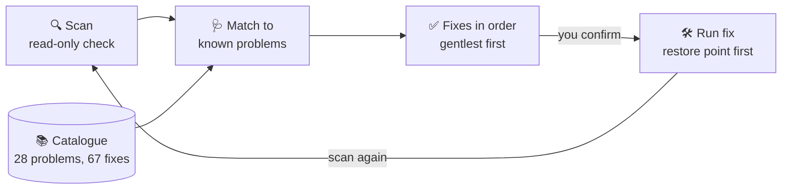

<h1 align="center">
  <br>
  <a href="https://github.com/sudharamachandranrajeev/shabda"></a>
  <br>
  Shabda
  <br>
</h1>

<h4 align="center">No sound on your Windows PC? Shabda finds the likely cause and walks you through fixes that others have confirmed.</h4>

<p align="center">
  <a href="https://github.com/sudharamachandranrajeev/shabda/releases"></a>
  
  
</p>

<p align="center">
  <a href="#-what-it-does">What it does</a> •
  <a href="#-get-started">Get started</a> •
  <a href="#-how-it-works">How it works</a> •
  <a href="#-faq-and-troubleshooting">FAQ</a> •
  <a href="#%EF%B8%8F-for-developers">For developers</a>
</p>

**Shabda** (Sanskrit: *sound*) is for anyone whose PC has gone quiet, crackles, or won't hear the
microphone. It checks the usual suspects in seconds, then shows fixes in order, from the gentlest
to the most invasive. Status: **early** (0.1.1, a pre-release). It covers 28 common problems, not
every one.

## ✨ What it does

- 🔍 **A quick check-up** – one click checks the audio services, speakers and microphones, Bluetooth
  audio, driver errors and microphone privacy settings. The check only reads; it changes nothing.
- 🩺 **Plain answers** – each problem found shows its symptoms, likely causes, and fixes to try in
  order.
- ✅ **Fixes others have confirmed** – every fix has at least two independent sources, such as a
  official Windows support page plus a user who says it worked. The sources are linked.
- 🛡️ **You stay in control** – before a fix runs, Shabda shows the exact script and asks you. Fixes
  that need administrator rights ask Windows first.
- ↩️ **A way back** – before a fix that needs administrator rights, tick one box to make a System
  Restore point (a snapshot you can return to) first.
- 🔎 **Search every known problem** – the scan found nothing? Search all 28 problems by symptom,
  such as "bluetooth no sound".
- 📴 **Nothing sent anywhere** – no account, no internet needed. Results stay on your PC.

<details>
<summary><b>The 28 problems it knows</b></summary>

| Area | Problems |
| --- | --- |
| No sound | No output device installed; volume meters move but nothing is heard |
| Wrong device | An app uses the wrong output; a device is disabled or hidden; the default switches by itself |
| Bluetooth | Too quiet; connected but silent; muffled when the mic is on; also connected to a phone; stutters with Wi-Fi |
| Drivers | Onboard audio stops after an update; the laptop smart sound (SST) driver shows Code 10 or a blue screen |
| HDMI, DisplayPort, USB | Monitor sound stops after sleep; monitor or TV missing; USB headset or DAC cuts out |
| Sound quality | Crackles and pops; dropouts from another driver; power-saving dropouts; sample-rate mismatch |
| Microphone | Headset jack mic; works in one app only; too quiet; not detected; blocked by privacy settings |
| Services and updates | Audio service stopped; sound stopped after an update; USB audio Code 10 after the September 2026 update |

Read the whole list, with every fix and source, without installing anything:
[Windows sound issues and verified fixes](docs/2026-10-28-windows-audio-issues.md).

</details>

## 🚀 Get started

### Step 1 – Download

Open the [releases page](https://github.com/sudharamachandranrajeev/shabda/releases) and, under the
newest release, pick a file:

| You want | File to download | Works on |
| --- | --- | --- |
| 🪟 The app | `Shabda-<version>-win-x64.exe` | Windows 10 and 11, 64-bit (x86) |
| 📜 Scripts only | `Shabda-<version>-scripts.zip` | Windows PowerShell 5.1 or PowerShell 7 |

Each release also has `SHA256SUMS.txt`, a list of fingerprints to check the files are genuine.

### Step 2 – Run it

Shabda is one file. There is nothing to install.

1. Optional: check the file is genuine. In PowerShell, run the line below and compare the result
   with the line for the exe in `SHA256SUMS.txt`:
   ```powershell
   Get-FileHash .\Shabda-*-win-x64.exe -Algorithm SHA256
   ```
2. Double-click `Shabda-<version>-win-x64.exe`.
3. Windows may say *"Windows protected your PC"*. This appears because the app isn't paid-signed
   yet, not because it is harmful. Click **More info → Run anyway**.

### Step 3 – Find and fix the problem

1. Click **Scan this PC**. It takes a few seconds.
2. Pick a problem from **Detected problems** on the left. The right side shows **Symptoms**,
   **Likely causes** and **Fixes — try in this order**.
3. Try the first fix. Some have a button:
   - **Open the setting** opens the right Windows settings page.
   - **Preview and run this fix…** shows the script first. Tick **Create a System Restore point
     first** if you want a way back, then click **Run fix**.
   - Fixes without a button are steps you follow yourself.
4. After a fix runs, Shabda scans again by itself. Still no sound? Try the next fix.
5. Nothing found? Choose **All known issues** and type your symptom in **Search**.

## 🧭 How it works



- **The scan** reads services, sound devices, Bluetooth, drivers and privacy settings, and changes
  nothing.
- **The catalogue** of problems and fixes is built inside the app, so it can't be changed on disk.
  Shabda never downloads or runs code from the internet.
- **A fix button** can only open a Windows settings page or run one of four built-in, low-risk
  scripts. Anything else is refused. Driver and registry fixes are steps you follow yourself.
- **Each fix you run** is logged to `%LOCALAPPDATA%\Shabda\logs\fixes.log`.

> [!IMPORTANT]
> Driver and registry fixes can be hard to undo. Make a System Restore point before you follow
> one: search the Start menu for **Create a restore point**.

## ❓ FAQ and troubleshooting

<details>
<summary><b>Windows says the app might be unsafe</b></summary>

The exe isn't code-signed (a paid certificate). Check it against `SHA256SUMS.txt` first. If the
fingerprint matches, click **More info → Run anyway**.
</details>

<details>
<summary><b>The scan found nothing, but there is still no sound</b></summary>

Choose **All known issues** and search your symptom, such as "hdmi" or "crackle". The scan can't see
every cause, such as a muted app or a loose cable.
</details>

<details>
<summary><b>Windows asks for administrator rights</b></summary>

Some fixes, such as restarting the audio services, need them. Click **Yes** to go on, or **No** to
stop. Nothing changes if you say no.
</details>

<details>
<summary><b>Can I use it without running the app?</b></summary>

Yes. Unzip `Shabda-<version>-scripts.zip` and run the read-only scan in PowerShell:

```powershell
powershell -ExecutionPolicy Bypass -File .\scripts\Diagnose.ps1
```

The fix scripts are in `scripts\fixes\`. Read one before you run it from an administrator
PowerShell.
</details>

<details>
<summary><b>Why is a popular fix missing?</b></summary>

Shabda only lists fixes with two independent sources. In this round, several community forums
blocked the research tools, so most sources are official Windows and vendor pages. Some
community fixes will arrive once a refresh can confirm them.
</details>

## 🛠️ For developers

<details>
<summary>Build, test and how the catalogue is made</summary>

You need the .NET 10 SDK on Windows.

```powershell
dotnet test
dotnet publish src/Shabda/Shabda.csproj -c Release -o publish
```

| Path | What |
| --- | --- |
| `src/Shabda` | The WPF app (.NET 10) |
| `tests/Shabda.Tests` | Unit tests |
| `scripts/Diagnose.ps1` | The read-only scan; `-AsJson` for JSON output |
| `scripts/fixes/` | The fix scripts the app can run |
| `data/issues.json` | The merged catalogue, built into the app |
| `data/curation.json` | Maintainer edits applied during the merge |
| `research/<date>/` | Research notes and source logs for each area |
| `tools/merge_issues.py` | Checks and merges the research into the catalogue |

**Confidence tiers:**

| Tier | Meaning |
| --- | --- |
| `verified` | An official Windows or hardware-vendor source, or an accepted high-vote answer, plus one more independent source |
| `strong` | At least two independent community sources where users confirm it worked |

Fixes with one source are left out and listed in the research notes. `tools/merge_issues.py`
enforces these rules in CI, and rejects any command that downloads or runs code from the internet.

- A `v*` tag tests, builds and publishes the exe, the scripts zip and `SHA256SUMS.txt`
  (`.github/workflows/release.yml`).
- Security reports: see [SECURITY.md](SECURITY.md).

</details>

## License

[MIT](LICENSE). This is not a Microsoft product. Fixes are provided as they are: make a restore
point before driver or registry changes.

---

> GitHub [@sudharamachandranrajeev](https://github.com/sudharamachandranrajeev)
